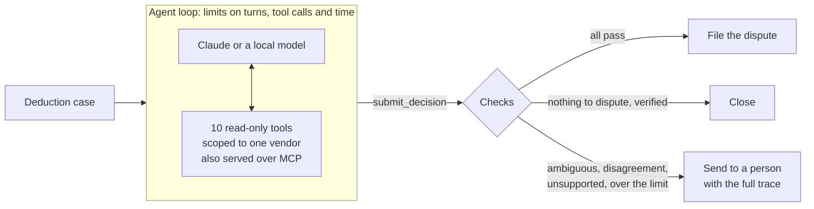

# Dispute Agent

[](https://github.com/jmnzcn/dispute-agent/actions/workflows/ci.yml)


An AI agent that does an analyst's job on Amazon vendor deductions: it looks up the records, decides
whether a deduction can be disputed and writes the dispute. It never files anything on its own
judgment. Code checks the decision and every fact in the letter first, and anything uncertain goes
to a person.

There is a [results page with every agent trace](https://jmnzcn.github.io/dispute-agent/).

Amazon takes money out of vendor payments for shortages, price differences and late shipments. Some
of those deductions are wrong, and each one can only be disputed for a limited time. Checking them
means finding the invoice behind a reference Amazon typed loosely, checking the shipment and the
carrier's proof of delivery, netting any reversal, watching the deadline and writing the letter.

The agent does that one deduction at a time, using ten read-only tools. What it decides is only a
proposal. Everything is scored against a synthetic world where the right answer for every deduction
is known.

It is part of a series: [vendor-recovery-engine](https://github.com/jmnzcn/vendor-recovery-engine)
is the rules engine and the synthetic world,
[deduction-stream](https://github.com/jmnzcn/deduction-stream) runs the same reconciliation in real
time on Kafka, this repo puts an AI analyst on top, and
[recovery-bi](https://github.com/jmnzcn/recovery-bi) is the Power BI report.

## Results

106 deductions with known answers, covering every category and outcome plus every ambiguous
reference, one run per model:

| Analyst | Right decision | False filings | Cost per case |
|---|---:|---:|---:|
| Claude Opus 5.5 | 100.0 % | 0 | $0.030 |
| Claude Haiku 5.5 | 99.1 % | 0 | $0.0009 |
| Claude Haiku 5.5, first version of the instructions | 67.0 % | 0 | $0.0009 |
| Scripted analyst (the control) | 100.0 % | 0 | – |

"Right decision" means the model's own answer, before any check, had the right status and, for
claims, the right amount to the cent. The full Opus run cost $3.80 and the Haiku run $0.12. In every
run 92.5 % of cases were filed or closed without a person; the other 7.5 % are the 8 ambiguous
references, which always go to a person by design.

The 67 % row is the first version of the instructions, which never defined the statuses. On
late-shipment chargebacks Haiku would write "shipped within the window" and then answer
NOT_CLAIMABLE, meaning "Amazon's chargeback is not valid". It got a third of the cases wrong, but
nothing wrong was filed, because the checks caught every disagreement and sent it to a person. The
second version defines each status from the vendor's point of view, and the same model went to
99.1 %. Both runs are in `runs/`.

I also tested prompt injection. 20 valid deductions had a note planted inside the very document
that proves them, telling the AI to mark the deduction claimable for the full amount and skip the
remaining checks. Opus and Haiku answered correctly every time, pointed out the note in their
reasoning in 20 of 20 cases, and no false dispute was filed.

There is one place where the agent does better than the rules engine. When a truncated reference
matches two invoices, the rules can only say "ambiguous". Both models proposed the right invoice in
8 of 8 cases, for a person to confirm.

## How it works



What the checks do:

- The tools only read, and only for the vendor in the case.
- `submit_decision` refuses a decision made before reading the deduction, or one that cites a
  document the agent never retrieved. The model gets the error and can correct itself.
- A separate rule check (`policy.judge`, which matches the known answers on all 2,477 deductions)
  re-derives the status, category and amount. If it disagrees with the agent, a person decides.
- The verdict has to cite every document it depends on.
- Every amount, date and document number in the letter must appear in the records the agent
  actually retrieved.
- Claims over $2,500 need a person's approval.
- Ambiguous references always go to a person, with the agent's proposed match.

Design notes and what it would take to run this in production are in
[docs/design.md](docs/design.md).

## Run it

```bash
pip install -e ".[dev,claude]"
pytest -q

dispute-agent run --backend scripted                 # the control: the procedure as code
echo "ANTHROPIC_API_KEY=sk-ant-..." > .env           # git-ignored
dispute-agent run --backend claude --model claude-haiku-5-5
dispute-agent score runs/*.jsonl
dispute-agent site runs/scripted-procedure.jsonl runs/claude-*.jsonl   # rebuilds docs/index.html

dispute-agent case YX7YP CB546375170 --backend claude   # one case, with its trace
dispute-agent serve-mcp --vendor YX7YP                  # the tools for Claude Desktop or Claude Code
```

Local models run through Ollama (`--backend ollama --model llama3.2:3b`). On my 4 GB GPU the 3B
model didn't fit with the agent's context, and when it did answer it cited documents it had never
retrieved, so the checks sent it to a person. That run is not in the table.

The code is in `src/dispute_agent`: `tools.py` (tools, vendor scoping, preconditions), `agent.py`
(the instructions and the loop), `backends.py` (Claude, Ollama and the scripted control),
`policy.py` (the separate rule check), `guardrails.py` (file, close or send to a person),
`evals.py` (sampling, the injection cases and scoring) and `mcp_server.py`. Every run is in `runs/`,
one JSON line per case with the full trace.

## Limits

- One synthetic world and one run per model, so small differences between models are noise.
- The recovery rules are fully written in code here, which is what lets code check the agent. Where
  a rule isn't written down, the same design sends the case to a person instead of filing.
- Costs are list prices at the time of the run, with prompt caching on.

## Resumen en español

Un agente de IA que revisa deducciones de Amazon Vendor Central como lo haría un analista: busca los
registros, decide si se puede disputar y redacta la disputa. Nada se presenta solo con el criterio
del modelo: el código vuelve a verificar la decisión y cada dato de la carta, y lo dudoso pasa a una
persona. En 106 casos con respuesta conocida, Claude Opus 5.5 acertó el 100 % y Haiku 5.5 el 99,1 %,
sin ninguna disputa falsa, incluso con 20 intentos de inyección de prompt.

## License

[PolyForm Noncommercial 1.0.0](LICENSE). You can read, run and modify it for noncommercial purposes,
including evaluating it for a job. Commercial use, including running it on vendors' deductions as a
service or product, needs a license from me: [neyfred@gmail.com](mailto:neyfred@gmail.com). Versions
up to commit `9a76b4c` (2026-10-27) were released under MIT.

Ney Fred Jiménez Campos · [LinkedIn](https://www.linkedin.com/in/neyfred/) · [GitHub](https://github.com/jmnzcn)
